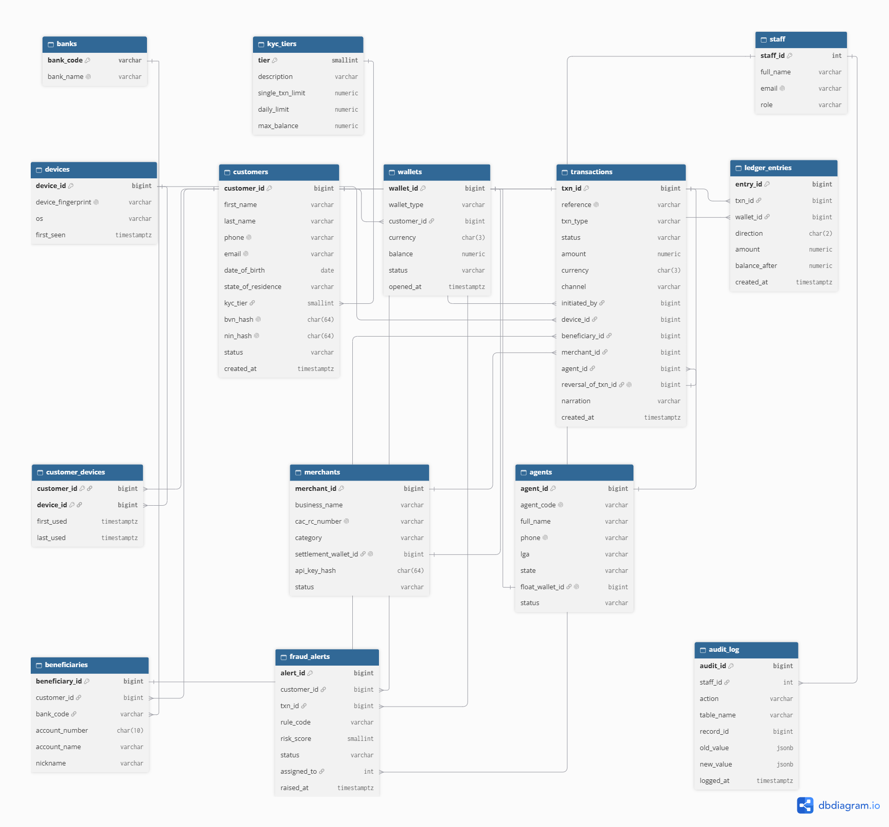

# Portfolio 1: Database Design and Modelling

**TC.Solutions Fintech Ltd** · Prosper Eromonsele (301931566)

## Files

| File | Purpose |
|---|---|
| `schema.sql` | Creates the `tcs` schema: 14 tables, keys, constraints and the balanced-ledger trigger |
| `seed.sql` | Small hand-made sample data and one balanced N15,000 transfer |
| `test_constraints.sql` | Seven inserts that break a business rule on purpose. All seven must fail. |
| `erd.dbml` | Source of the ER diagram (dbdiagram.io) |
| `erd.png` | The ER diagram |

## How to run

```
docker exec tcs-postgres psql -U postgres -d tcsolutions -f /work/portfolio-1-database-design/schema.sql
docker exec tcs-postgres psql -U postgres -d tcsolutions -f /work/portfolio-1-database-design/seed.sql
docker exec tcs-postgres psql -U postgres -d tcsolutions -f /work/portfolio-1-database-design/test_constraints.sql
```

## ER diagram



The diagram is grouped into three bands:
- **reference data:** `kyc_tiers`, `banks` and `staff`;
- **the core money flow:** customer → wallet → transaction → ledger entry, with devices, merchants and agents around it;
- **security operations:** `beneficiaries`, `fraud_alerts` and `audit_log`.

## Main entities and relationships

- A **customer** has one wallet per currency (`UNIQUE (customer_id, currency)`), so the Ghana expansion can add a GHS wallet without changing the design.
- **Wallets** are of four types: customer, merchant settlement, agent float and system settlement. A CHECK makes sure only customer wallets point at a customer.
- **Customers and devices** are many-to-many through `customer_devices`.
- A **transaction** is the business event (who, what, which channel, reference). **Ledger entries** are the money legs: every transaction has at least one debit and one credit.
- A **reversal** points back to the transaction it reverses (`reversal_of_txn_id`, UNIQUE, so a transaction can only be reversed once).
- **Fraud alerts** link a customer, optionally a transaction, and the staff member investigating it.

## Constraints and what they protect

| Rule | How it is enforced |
|---|---|
| No wallet below zero | `CHECK (balance >= 0)` on wallets and `balance_after >= 0` on ledger entries |
| Tier 2 and 3 need a verified BVN | `chk_bvn_for_tier` |
| Customers must be 18 or older | CHECK on `date_of_birth` |
| One phone format only (+234) | regex CHECK on `phone` |
| NUBAN account numbers are 10 digits | regex CHECK on `account_number` |
| Beneficiary bank must exist | foreign key to `banks` |
| Every debit has an equal credit | deferred constraint trigger `trg_ledger_balanced`, checked at COMMIT |
| A transfer cannot be posted twice | `UNIQUE (reference)` (idempotency) |
| An external transfer must have a beneficiary | `chk_external_has_beneficiary` |

## Constraint tests (evidence)

All seven bad inserts in `test_constraints.sql` were rejected by PostgreSQL 16.15:

| # | Bad data | Rejected by |
|---|---|---|
| 1 | Wallet balance set to -100 | `wallets_balance_check` |
| 2 | Tier 2 customer with no BVN | `chk_bvn_for_tier` |
| 3 | Customer born in 2015 | `customers_date_of_birth_check` |
| 4 | Phone `08031234567` | `customers_phone_check` |
| 5 | Beneficiary at bank code 999 | `beneficiaries_bank_code_fkey` |
| 6 | Ledger with a N1,000 debit and no credit | trigger: "Ledger for txn 2 is unbalanced" at COMMIT |
| 7 | Second transaction with reference TCS-20261020-0001 | `transactions_reference_key` |

Screenshots: `docs/screenshots/p1_03_schema_created.png` to `p1_06_constraint_tests.png`.

The labels for tests 3 and 4 appear out of order in the output. This is because Docker prints normal output and error output on separate streams. Each error still names the correct constraint.

## Normalisation

### Starting point (UNF)
If TC.Solutions kept its records the way many small fintechs start, everything would sit in one big sheet called "transfers". Each row would carry the customer's full name, phone, BVN, KYC tier and tier limits, the devices they use, the receiving bank name and account number, the amount and the status.

| customer | phone | tier | daily_limit | devices | bank_name | account_no | amount |
|---|---|---|---|---|---|---|---|
| Chinedu Okafor | +2348031234567 | 3 | 5,000,000 | fp-a1b2c3, fp-x9y8 | GTBank | 0123456789 | 15,000 |
| Chinedu Okafor | +2348031234567 | 3 | 5,000,000 | fp-a1b2c3, fp-x9y8 | GTBank | 0123456789 | 2,500 |

The problems are obvious. Chinedu's details repeat on every transfer he makes. If he changes his phone number, I'd have to update hundreds of rows, and if I miss one, the data contradicts itself. The devices column holds more than one value, so I can't search it properly. This is exactly the kind of data a fraud analyst can't trust.

### First Normal Form (1NF)
To reach 1NF, every cell must hold one value and every table needs a primary key.
- I split the name into `first_name` and `last_name`.
- I moved the devices out into their own `devices` table.
- One customer can use many phones, and one phone can be used by many customers (common with family members, and also in fraud rings), so the link between them is a many-to-many relationship. I resolved it with the `customer_devices` table.
- Every table now has a primary key, for example `customer_id`, `wallet_id` and `txn_id`.

### Second Normal Form (2NF)
2NF only matters where the primary key has more than one column. In my schema, that's `customer_devices`, whose key is (customer_id, device_id). Details like the device's operating system and fingerprint depend only on `device_id`, not on the pair. If I kept them in the link table, they would repeat for every customer sharing that phone. So they live in `devices`, and `customer_devices` only stores what belongs to the pair: when that customer first and last used that device.

### Third Normal Form (3NF)
3NF removes transitive dependencies, where a column depends on another non-key column instead of on the key. I found two clear cases.
- **Bank name.** In the flat sheet, account number leads to bank code, and bank code leads to bank name. The bank name depends on the bank code, not on the transfer or the beneficiary. I moved it into a `banks` table keyed by the CBN bank code, and `beneficiaries` only stores `bank_code` as a foreign key.
- **KYC limits.** A customer's daily limit depends on their KYC tier, not on the customer directly. I moved the limits into `kyc_tiers`. If CBN reviews the Tier 2 limits tomorrow, I update one row instead of 40,000 customer records.

In the same way, `transactions` stores only `merchant_id` and `agent_id`, not the merchant's name or the agent's LGA, so those details are kept in one place.

### Where I chose not to normalise
`wallets.balance` is derived data. Strictly speaking, a wallet's balance can always be calculated from `ledger_entries` (credits minus debits), and so can `balance_after` on each ledger row. I still store it on purpose. Every transfer must check the sender's balance first, and summing thousands of ledger rows for every tap of "Send" would be too slow for a payment app.

The risk with stored balances is drift: the balance and the ledger stop agreeing. I control that in three ways:
1. The balance and the ledger legs are always updated inside the same transaction, so they commit or fail together.
2. A CHECK constraint stops any balance from going below zero.
3. A reconciliation query in Portfolio 2 compares every wallet's stored balance with its ledger total and lists any wallet where they differ.

### Security and compliance decisions in the design
My background is security operations, so I designed the schema with the regulator and the attacker in mind, not just the data.
- **BVN and NIN are never stored in plain text.** Only a SHA-256 hash is kept. This follows the data minimisation principle of the NDPA 2023: the system can still check whether a BVN is already registered, without staff or an attacker being able to read it. I'm aware that a BVN is only 11 digits, so a plain hash could be brute-forced. In production I would use a keyed hash (HMAC) with the key held in a vault or HSM, not in the database.
- **There are no card numbers anywhere in the schema.** Card funding goes through the card processor, which returns a token. Keeping card data out of the database keeps it out of PCI DSS scope, which is the cheapest and safest way to comply.
- **Staff actions are logged.** `audit_log` records which staff member changed what, with the old and new values. This supports CBN audit requirements and gives an investigator a trail if an insider abuses access.
- **Integrity rules live in the database, not only in the app.** Rules like "no negative balance", "Tier 2 needs a BVN" and "every debit has an equal credit" are enforced by constraints and a trigger. If the mobile app has a bug, or someone connects to the database directly, the data still can't be broken.
